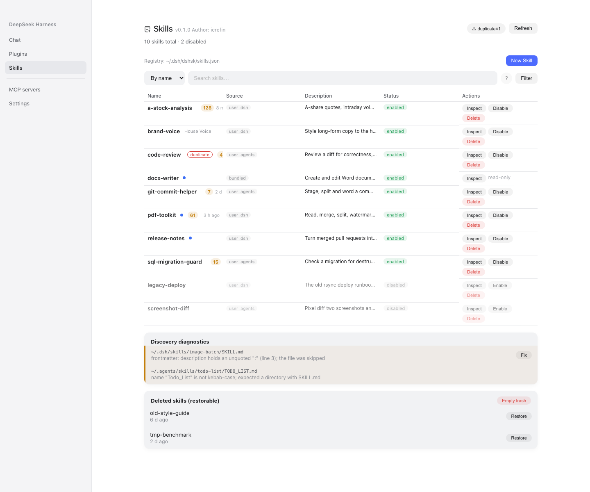
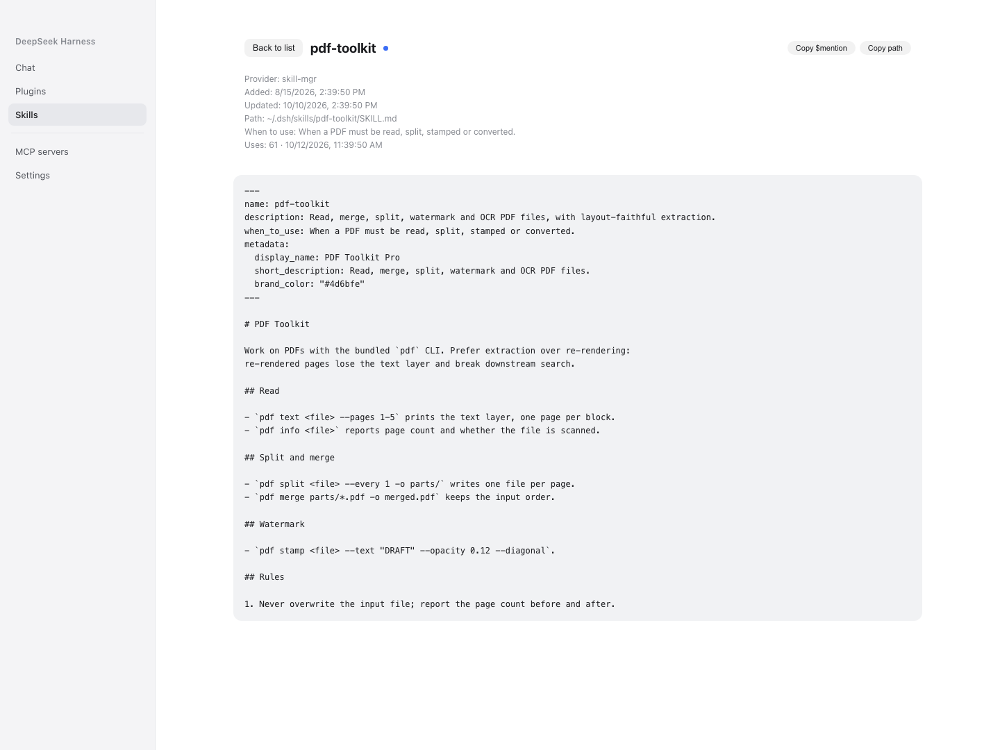

# dsh-skill-mgr

**Every skill in one list** — the whole profile inventory in a sidebar panel: see what is installed, read a skill's body, enable or disable it, repair a discovery problem, and delete it into a trash you can restore from.

**English** | [简体中文](README.zh-CN.md)

[](LICENSE)
[](https://github.com/icrefin/dsh-skill-mgr/releases)
[](https://github.com/icrefin/dsh-skill-mgr/actions/workflows/ci.yml)
[](https://github.com/icrefin/dsh-skill-mgr/commits/main)
[](https://github.com/icrefin/dsh-skill-mgr/stargazers)
[](https://github.com/icrefin/dsh-skill-mgr/pulls)
[](https://nodejs.org)
[](https://github.com/deepseek-ai/deepseek-harness)

> If this plugin saves you a hunt through `~/.dsh/skills`, a ⭐ star helps the next person find it.

## Why this exists

A skill is a folder with a discovery file in it, which is easy to create and hard to keep track of: which ones exist, which are currently switched off (a renamed file is invisible, not absent), which one has a broken frontmatter, and which are duplicates across the two writable roots. This plugin is the one place that answers those questions, without an editor open and without hand-renaming files.

**Enabled is the default, and disabling is a filesystem fact first.** The discovery file is renamed (`SKILL.md` → `SKILL.md.disabled`, or `<name>.md` → `<name>.md.disabled`) so the filesystem provider simply stops seeing it; a registry record is what lets the panel still list it and switch it back on.

## Screenshots



*Skills — one flat table over the profile inventory (enabled and disabled alike), with search, a source filter, use-count and last-used chips, the discovery diagnostics and the restorable trash.*



*Inspect — the skill's body and metadata, with the enable/disable action for a disabled skill.*

## The registry file

```
<profile>/.dsh/dshsk/skills.json      the profile's skill management state
```

One registry holds everything the manager persists: the disabled-skill records, the trash, and the statistics checkpoint. It is reconciled at startup — a `.disabled` file with no record is adopted (an upgraded or hand-edited install), and a record whose file is gone is dropped. Writes go through an atomic same-directory temp file (`wx`, mode `0600`, then `rename`), and a read that hits unparsable JSON refuses to overwrite it and reports why.

## Features

| Surface | What it does |
|---|---|
| Sidebar row | sits directly under **Plugins** (`order: 1`) and opens the **Skills** page in the centre column |
| Skills table | one flat table of the profile inventory — Name / Source / Description / Status / Actions — with search, sorting and a source filter |
| Enable / disable | renames the discovery file and keeps the record, so the row stays visible (dimmed) and can be switched back on |
| Inspect | reads a skill's body and metadata without leaving the GUI |
| Add skill | scaffolds a new skill in a writable root |
| Discovery diagnostics | lists the skills the provider cannot see, and auto-fixes the repairable ones in place |
| Restorable trash | `Delete` moves a skill into the root's `.trash`; the panel lists it with a Restore action, and clearing the trash is explicit |
| Chat `/` menu dots | marks each candidate row as model-invocable or user-invocable, coloured from the same settings the panel reads |
| Settings card | the plugin's own configuration, in the Plugins manager |
| Attribution | the title chip carries the installed version and the author credit |

## Requirements

- Node.js `^22.19.0 || >=24.0.0`
- A DeepSeek Harness `0.2.0-rc.2` installation (the plugin composes into a profile)
- `pnpm` 11.8.0 (`packageManager` in the manifest pins it)

## Installation

```sh
pnpm install
pnpm check                        # typecheck → build → tests → verifiers
pnpm pack                         # dist/dsh-skill-mgr-<version>.tgz
sh tools/install-into-profile.sh desktop
```

Restart DeepSeek Harness afterwards; the sidebar entry appears directly under **Plugins**.

The package is not on npm: the profile installs it from this repository. `dsh plugin` (a pnpm passthrough into the profile directory) is what the script uses, and the Plugins page does the same thing. The desktop profile is owned by the Electron application, so `dsh --profile desktop` itself refuses to compose it, while `dsh plugin` still works.

Upgrading from `dsh-skill-hub`? The two packages must not both be installed — they would both claim the plugin-config card. Remove the old bundle first; the new plugin adopts the old state file on its first load and leaves it untouched.

## Quick start

1. Open **Skills** in the sidebar. The table lists every skill in `~/.dsh/skills` and `~/.agents/skills`.
2. Search for a skill; select **Inspect** to read it, or **Disable** to switch it off for the whole profile.
3. Select **Add skill** to scaffold a new one in a writable root.
4. Read the diagnostics banner when something is not being discovered, and use its fix action on the repairable entries.

## Configuration

The Loader entry's config is the settings card; the host reads the same values through their volatile refs.

| Field | Default | Meaning |
|---|---|---|
| `enabled` | `true` | contribute the skill provider and the announcement; the management panel keeps working either way, because it is the surface that turns the plugin back on |
| `announceToAgent` | `true` | register the system-prompt section that tells an agent this manager exists |
| `showUseCount` | `true` | per-skill invocation-count chip |
| `showUseTime` | `true` | per-skill last-used relative time |
| `dotModelColor` | unset | `#rrggbb` for the "model-invocable" dot, in the table and the chat `/` menu |
| `dotUserColor` | unset | `#rrggbb` for the "user-invocable only" dot |
| `statsWindowDays` | `14` | rolling window for the counts; `0` = all history |
| `statsScanMinutes` | `5` | background session-log scan interval, in minutes |

## Remote surface

The browser half reads and writes through one Typert Remote namespace, `skillMgr`. Two conventions cover the whole surface: `snapshot()` is the one read (the panel loads all of its slices from a single call, cached for one render pass), and every write answers `SkillApplyResult` (`{ok:true}` / `{ok:false, error}`) after which the caller refetches.

| Area | Methods |
|---|---|
| Core | `snapshot` |
| Profile inventory | `saveGlobalSkill`, `removeGlobalSkill`, `setGlobalSkillEnabled`, `skillDetail`, `fixDiagnostic`, `skillStats` |
| Trash | `restoreTrashedSkill`, `clearTrash` |

Nine methods in total. Their parameter and result types live in `src/wire.ts` as zod schemas, and each type is `z.infer` of its schema, so the host implementation, the descriptors and the browser half cannot drift apart.

## Caveats

- **Enable/disable is profile-wide, not per workspace.** Because toggling renames one discovery file, there is no way to have a skill on in one workspace and off in another; every workspace is offered every skill in the profile inventory. A reader who needs per-workspace on/off cannot have it here.
- **Project skills are discovered, not managed.** The provider lists a workspace's own roots so an agent still sees the skills beside it, but they are never part of the profile inventory the panel manages: they cannot be toggled, deleted or adopted. Only `~/.dsh/skills` and `~/.agents/skills` are writable.
- **Writable roots are user-level only**, and a refusal names the source that owns the skill.
- **Deletion is recoverable but has no automatic expiry.** `Delete` moves the skill into the root's `.trash` directory and the panel lists it with a Restore action; clearing the trash is permanent.
- **A local install pins the tarball's path.** Delete `dist/dsh-skill-mgr-<version>.tgz` and the next install fails with `ENOENT`.
- **There is no update check.** This package is heavily refactored from `dsh-skill-hub`, so tracking upstream releases would be misleading and there is no release channel of this package to poll.

## License and attribution

MIT — see [LICENSE](LICENSE). This package was refactored from `dsh-skill-hub` 0.3.18 (MIT, "dsh-skill-hub contributors"); that copyright line is kept in the LICENSE file, and the differences from upstream are documented in [docs/ARCHITECTURE.md](docs/ARCHITECTURE.md).

> Stars are how small projects survive. If this one earned yours, tap ⭐ — it costs nothing and helps someone else find it.
